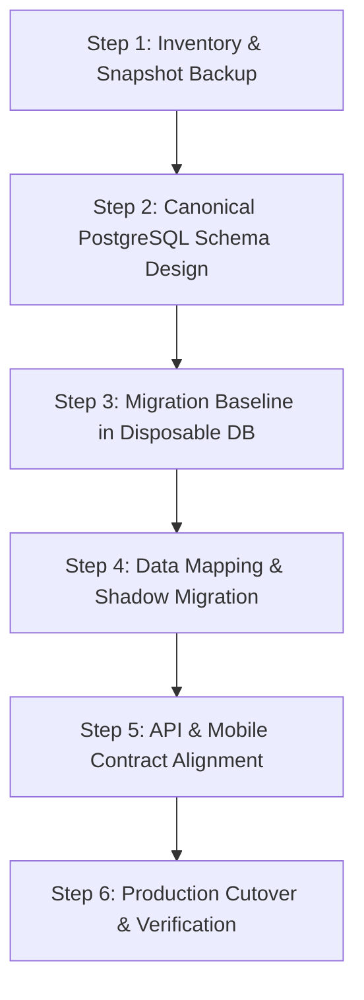

# Phase 1: Database Consolidation & PostgreSQL Migration Plan

**Generated:** 2026-11-18  
**Author:** Database Migration & Relational Architecture Lead  
**Authority:** ADR-003 (PostgreSQL as the Single Authoritative Database Schema)  
**Safety Protocol:** Read-only planning in Phase 1. No production migrations executed. `database/dev.db` preserved.

---

## 1. Schema Duality Inventory & Current Runtime Mapping

The repository currently contains three distinct Prisma schema files:

| Schema Path | Provider | Primary Key Types | Key Models | Runtime Consumers |
| :--- | :---: | :---: | :--- | :--- |
| **`database/prisma/schema.prisma`** | SQLite | String UUID (`@default(uuid())`) | `User`, `Destination`, `Hotel`, `RoomType`, `RoomInventory`, `HotelBooking`, `TaxiCompany`, `Taxi`, `Restaurant`, `LocalRide`, `TourPackage`, `Subscription`, `Payment`, `LocalRideBooking`, `RideOffer`, `Review` | `database/prisma/seed.ts` |
| **`services/api/prisma/schema.prisma`** | SQLite | Int Autoincrement (`@default(autoincrement())`) | `User`, `Destination`, `PlaceToVisit`, `Hotel`, `Tour`, `Booking`, `Ride`, `Taxi`, `Restaurant`, `Package`, `Review` | `services/api/src/*` (controllers, Vitest tests, PrismaClient) |
| **`services/api/prisma/schema.postgres.prisma`** | PostgreSQL | Int Autoincrement (`@default(autoincrement())`) | Exact PostgreSQL replica of `services/api/prisma/schema.prisma` with `postgresql` provider | Currently unreferenced draft |

### Key Architectural Drift Identified
1. **Model Duality:** `database/` uses `HotelBooking` and `LocalRideBooking`, while `services/api/` uses a generic `Booking` table with JSON `details` string column and `Ride` table.
2. **Identifier Duality:** `Hotel.id` is a UUID String in `database/prisma/schema.prisma`, but an Int autoincrement in `services/api/prisma/schema.prisma`.
3. **Migration Directory:** Neither folder has an initialized `prisma/migrations/` directory; migrations were applied using `prisma db push` on local SQLite files.
4. **Prisma Client Generation Path:** Both schemas target `@prisma/client`, resulting in generator clobbering depending on which workspace executes `prisma generate`.

---

## 2. Authoritative Target Architecture (Per ADR-003)

### Single Canonical Schema Location
**`database/prisma/schema.prisma`** is designated as the sole authoritative schema file:
- Datasource: `provider = "postgresql"` with `url = env("DATABASE_URL")`.
- Generator: Generates client to a unified, shared location referenced by `services/api`.
- Database Extension: `postgis` enabled for spatial indexing (`ST_DWithin`, geometry coordinates).

### Target Domain Model Hierarchy
The reconciled domain model must reflect the corrected product requirements:
1. `User` (Authentication & identity)
2. `BusinessProfile` (One user can own multiple businesses: Hotel, Taxi Service, Restaurant, Tour Agency, Local Ride)
3. `BusinessLocation` (A business profile may operate multiple physical branches/locations)
4. `StaffMembership` (Scoped staff roles per business profile)
5. `CategoryEntitlement` (Enforces permanently free rules for restaurants and local drivers; manages annual subscriptions for hotels, taxis, tours)
6. `MiniSiteRevision` (Dual-state content: published revision vs pending draft revision)
7. `Enquiry` (Customer direct leads; distinct from bookings)
8. `Subscription` & `SubscriptionPayment` (Razorpay partner subscription billing ledger)

---

## 3. Step-by-Step Non-Destructive Migration Plan



### Phase A: Non-Destructive Preparation (Current Phase 1)
- Preserve `database/dev.db` and existing SQLite development flows untouched.
- Create disposable Dockerized PostgreSQL + PostGIS test environment (`postgis/postgis:15-3.3`).
- Reconcile `schema.prisma` without dropping existing SQLite files.

### Phase B: Expand-and-Contract Identifier Migration Strategy
To transition from Int IDs to UUIDs safely without breaking running API endpoints:
1. **Expand:** Add a new `uuid` column (`uuid String @unique @default(uuid())`) alongside existing `id Int` columns on all target tables.
2. **Backfill:** Populate the `uuid` column for all existing records via a deterministic migration.
3. **Dual-Read:** Update API queries to resolve resources by either integer `id` or string `uuid`/`slug`.
4. **Contract:** Once all clients migrate to UUIDs and slugs, promote `uuid` to primary key and deprecate legacy integer foreign keys.

### Phase C: PostGIS Geospatial Capability Verification
The production database uses `postgis/postgis:15-3.3`:
```sql
CREATE EXTENSION IF NOT EXISTS postgis;
CREATE INDEX idx_locations_coordinates ON "BusinessLocation" USING GIST (
  ST_SetSRID(ST_MakePoint(longitude, latitude), 4326)
);
```
Enables sub-millisecond radius discovery queries (`ST_DWithin`) across destinations, hotels, restaurants, and cabs.

---

## 4. Rollback and Disaster Recovery Procedures
1. **Pre-Migration Snapshot:** Full logical dump using `pg_dump -Fc -v travel_db > backup_pre_migration.dump`.
2. **Restoration Verification:** Automated restore rehearsal into a temporary database `travel_db_test_restore` before running migrations on persistent volumes.
3. **Abort Trigger:** If schema migration causes any referential integrity violation or data truncation, rollback transaction immediately (`ROLLBACK`) and revert application pointer.
